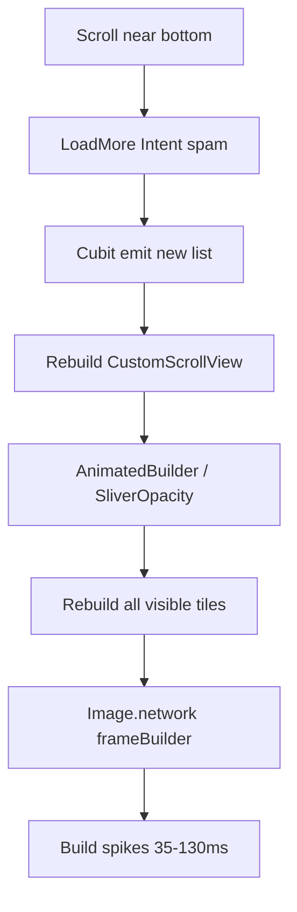

# Plan: Fix Chrome Pokédex list lag

Runtime evidence from session `5c95c3` (Chrome / Flutter web). Instrumentation remains in place for post-fix verification.

## Verdict from logs

| Hypothesis | Result | Evidence |
|---|---|---|
| **A** Image decode / frame churn | **CONFIRMED** | `imageFrameCount` reached **2520**; `maxBuildMs` spikes **100–130ms** |
| **B** Full-tree Bloc rebuilds | **PARTIAL** | Load-more emits rebuild nav+filter+grid; amplifies A/C/E |
| **C** `AnimatedBuilder` + `SliverOpacity` | **CONFIRMED** | **105** transition rebuilds, **104 while animating**; rebuilds whole grid every tick |
| **D** Load-more scroll thrash | **CONFIRMED** | **44** `LoadMore` commands, **34 ignored**; scroll still hammers Intent/Cubit |
| **E** Per-tile rebuild amplification | **CONFIRMED** | **2880** tile builds with only **≤210** pokemon (~14× overbuild) |

Raster is fine (`avgRasterMs` ~1.4). Lag is **UI-thread build cost**, not GPU fill.

## Priority fixes

### P0 — Stop rebuilding the whole grid on opacity ticks
**Where:** [`pokemon_filter_transition_sliver.dart`](packages/pokemon/lib/presentation/views/widgets/pokemon_filter_transition_sliver.dart)

`AnimatedBuilder` currently reconstructs `SliverGrid` every animation frame. That alone explains hundreds of tile builds during load/filter fades.

**Change:**
- Keep a stable grid child (or use `FadeTransition` / opacity only around a child that is **not** rebuilt every tick).
- Prefer `SliverAnimatedOpacity` / wrap content so the builder receives a cached `child`, or drive opacity without recreating `SliverChildBuilderDelegate` children each tick.
- Avoid setting `tileFadeStartIndex` to the full list length on first paint (today first load fades **all** 30 tiles **and** runs grid opacity).

### P0 — Decode images at display size on web
**Where:** [`pokemon_grid_tile.dart`](packages/pokemon/lib/presentation/views/widgets/pokemon_grid_tile.dart)

`Image.network` has no `cacheWidth` / `cacheHeight`, so full sprites decode then scale down.

**Change:**
- Pass `cacheWidth` / `cacheHeight` from layout (tile size × `devicePixelRatio`).
- Consider dropping per-frame `PokemonGridTileImageFade` on web, or only fade once with a cheaper placeholder swap.
- Optional: `RepaintBoundary` around each tile.

### P1 — Gate LoadMore at the scroll edge
**Where:** [`pokemon_list_screen.dart`](packages/pokemon/lib/presentation/views/pokemon_list_screen.dart) `_onScroll`

Cubit correctly ignores duplicates, but Intent → Action → `execute()` still runs dozens of times.

**Change:**
- Only invoke LoadMore when `extentAfter < threshold` **and** not already loading / already requested for current offset.
- Track `_loadMoreRequested` locally; clear when `isLoadingMore` becomes false.

### P1 — Narrow Bloc rebuild scope
**Where:** [`pokemon_list_screen.dart`](packages/pokemon/lib/presentation/views/pokemon_list_screen.dart)

**Change:**
- Split filter bar / nav from grid with `BlocSelector` / nested builders so load-more only rebuilds the grid + footer.
- Add `buildWhen` so identical filter/title chrome does not rebuild.

### P2 — Soften load-more tile entrance
**Where:** fade-in path in filter transition sliver

Fading in every newly appended tile creates N `AnimationController`s per page.

**Change:**
- Fade only newly visible tiles, or skip fade-in on web / when appending pages.
- Cap concurrent entrance animations.

## Out of scope (for this pass)

- Switching remote GraphQL ↔ REST (not implicated by frame timings).
- Replacing Drift (already Memory on web).
- Removing localization (not on the hot path for jank).

## Verification

Keep current `agentDebugLog` probes. After fixes, hot-restart Chrome and compare:

| Metric | Before (measured) | Target |
|---|---|---|
| `tileBuildCount` after ~120 pokemon scrolled | ~2880 | closer to visible×pages (hundreds, not thousands) |
| `imageFrameCount` | ~2520 | roughly ≈ unique images loaded |
| `LoadMore` ignored | 34 | near 0 (gated in scroll) |
| `maxBuildMs` | 100–130 | mostly &lt; 32 |
| `avgBuildMs` during scroll | often 15–24 | mostly &lt; 12 |

## Implementation order

1. P0 grid opacity rebuild fix — **DONE** (cached `AnimatedBuilder` child). Partial win: tile builds down, but build spikes / image churn remain.
2. P0 image cache size — **DONE**
3. P1 LoadMore scroll gate — **DONE**
4. P1 BlocSelector split — **DONE**
5. P2 fade-in softening — **DONE**
6. Remove debug instrumentation — **DONE**
